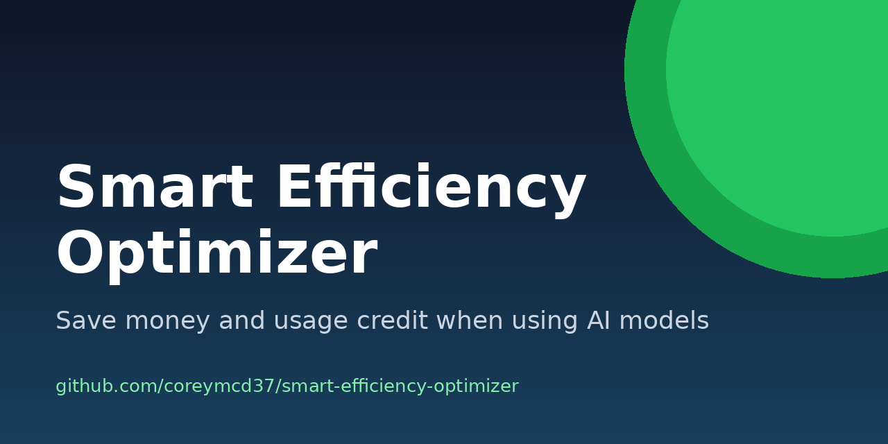

<p align="center">
  
</p>

# Smart Efficiency Optimizer

**Save money and usage credit when using AI models.**

[](LICENSE)
[](CONTRIBUTING.md)
[](https://github.com/coreymcd37/smart-efficiency-optimizer/commits/main)

## Contents

- [What it is](#what-it-is)
- [Why it saves money and credits](#why-it-saves-money-and-credits)
- [What's in this repo](#whats-in-this-repo)
- [Quick start](#quick-start)
- [Using it with an API](#using-it-with-an-api)
- [Quick mode vs. Full mode](#quick-mode-vs-full-mode)
- [FAQ](#faq)
- [Roadmap](#roadmap)
- [Contributing](#contributing)
- [License](#license)

## What it is

I put this together because I kept burning through usage credits and paying for big models on work that didn't need them. The Smart Efficiency Optimizer is a reusable set of instructions you give an AI model so it picks the cheapest, fastest, most reliable way to get a job done, without cutting corners on accuracy, privacy, or safety.

## Why it saves money and credits

- **Right-sizes the work.** Small tasks get a quick answer, not a 3-page plan.
- **Climbs a decision ladder.** Skip it, reuse it, use free tools, or write a script before reaching for an expensive model.
- **Uses cheap models first** and only escalates hard or flagged cases to a stronger one.
- **Cuts tokens.** Shorter prompts, trimmed inputs, controlled output length, caching, and batching.
- **Caps retries and spend** so a stuck task doesn't quietly drain your credits.
- **Keeps accuracy as a hard floor,** because cheap and wrong ends up costing more.

## What's in this repo

| File | Use it when |
|---|---|
| [`SMART-EFFICIENCY-OPTIMIZER.md`](SMART-EFFICIENCY-OPTIMIZER.md) | You want the full guide (recommended). |
| [`prompts/smart-efficiency-optimizer.txt`](prompts/smart-efficiency-optimizer.txt) | You want the same guide as plain text for easy copy and paste. |
| [`prompts/compact.md`](prompts/compact.md) | Your tool has a short character limit for instructions. |
| [`examples/`](examples/) | You want to see what the output looks like on real-world tasks. |

## Quick start

1. Open [`prompts/smart-efficiency-optimizer.txt`](prompts/smart-efficiency-optimizer.txt), click **Raw**, and copy everything.
2. Paste it into your tool's standing instructions (see below).
3. Give it a real task, like "Summarize 500 support tickets by category."
4. Small jobs get Quick mode. Bigger jobs get Full mode: a recommended plan, an options comparison, cost estimates, and a small pilot before scaling.
5. Run the pilot, check the results, then scale.

Where to paste it:

- **ChatGPT:** Settings → Personalization → Custom instructions, or the instructions box of a custom GPT or Project.
- **Claude:** a Project's custom instructions, or Settings → Profile preferences for every chat.
- **Gemini:** create a Gem and paste it into the Gem's instructions.
- **GitHub Copilot:** save it as `.github/copilot-instructions.md` in your repo, or add it to your personal custom instructions.
- **Other chat apps and coding agents:** the system prompt, project rules, or instructions file.

If your tool's box is too small for the full guide, use [`prompts/compact.md`](prompts/compact.md). Menu names change from time to time, so check your tool's help pages if a setting has moved.

## Using it with an API

Send the guide as the system message, then your task as the user message. Example with an OpenAI-style chat API (swap in whichever model and SDK you use):

```python
from pathlib import Path
from openai import OpenAI

guide = Path("prompts/smart-efficiency-optimizer.txt").read_text()
client = OpenAI()  # reads your API key from the OPENAI_API_KEY environment variable

response = client.chat.completions.create(
    model="YOUR-MODEL-NAME",
    messages=[
        {"role": "system", "content": guide},
        {"role": "user", "content": "Summarize 500 support tickets by category."},
    ],
)
print(response.choices[0].message.content)
```

Tips:

- Keep the guide at the very start of the prompt so providers that support prompt caching can reuse it.
- For Anthropic's API, pass the guide in the `system` parameter. For Gemini, use `system_instruction`.
- Keep API keys in environment variables, never in code or prompts.

## Quick mode vs. Full mode

**Quick mode** (small, low-risk task):

> **You:** Rename these 40 photos to the date they were taken.
>
> **Model:** This is deterministic, so a short script beats an AI model. Here's a 6-line script that reads each photo's date and renames it. Run it on a copy of the folder first.

**Full mode** (big, repeating, or costly job):

> **You:** Every week I get about 2,000 customer emails and need them tagged by topic and urgency.
>
> **Model:** **Recommended plan:** tag with a small, fast model and send only low-confidence emails to a stronger model, because that's the cheapest approach that meets your quality bar. Then an options table, a workflow, a low/expected/high cost estimate using `emails × tokens per email × price per token` (verify current pricing), risks, and a pilot on 50 emails before scaling.

See [`examples/`](examples/) for complete worked examples.

## FAQ

**Does it work with any model?**
Yes. It's plain instructions, so it works with any chat model or API that accepts a system prompt or custom instructions.

**Will it make answers worse?**
It shouldn't. Accuracy is a hard floor in the guide, and higher-risk work gets more checks, not fewer.

**Why doesn't it list prices or model names?**
Prices, limits, and model names change often. The guide tells the model to check official pricing pages, or to use relative ratings (Free / $ / $$ / $$$) and say "verify current pricing".

**It's too long for my tool's instructions box.**
Use [`prompts/compact.md`](prompts/compact.md).

**Can I change it for my team or company?**
Yes. It's MIT licensed. Fork it, trim it, and adapt it.

## Roadmap

- [ ] Setup guides for more tools and coding agents
- [ ] Model-specific tips
- [ ] More worked examples
- [ ] Translations
- [ ] A simple cost-estimate worksheet

Have an idea? [Open an issue](https://github.com/coreymcd37/smart-efficiency-optimizer/issues/new/choose) or start a [discussion](https://github.com/coreymcd37/smart-efficiency-optimizer/discussions).

## How this was made

I developed and tested this guide through my own AI-assisted workflow. I wrote the rules, ran them against real tasks in several models, compared the output and cost, and kept only what held up. It's the same approach I use when I build software: I set the direction, review every result and ship what passes.

— [Corey McDaniel](https://coreymcdaniel.com)

## Contributing

This is meant to grow. If you have a better rung for the ladder, a token-saving trick, a tool-specific setup guide, or a fix, I'd love your help. Open an issue, start a discussion, or send a pull request. Everyone's welcome to build on it, collaborate, and contribute. See [CONTRIBUTING.md](CONTRIBUTING.md) to get started, and look for issues labelled [`good first issue`](https://github.com/coreymcd37/smart-efficiency-optimizer/labels/good%20first%20issue).

## License

[MIT](LICENSE) © 2026 Corey McDaniel
